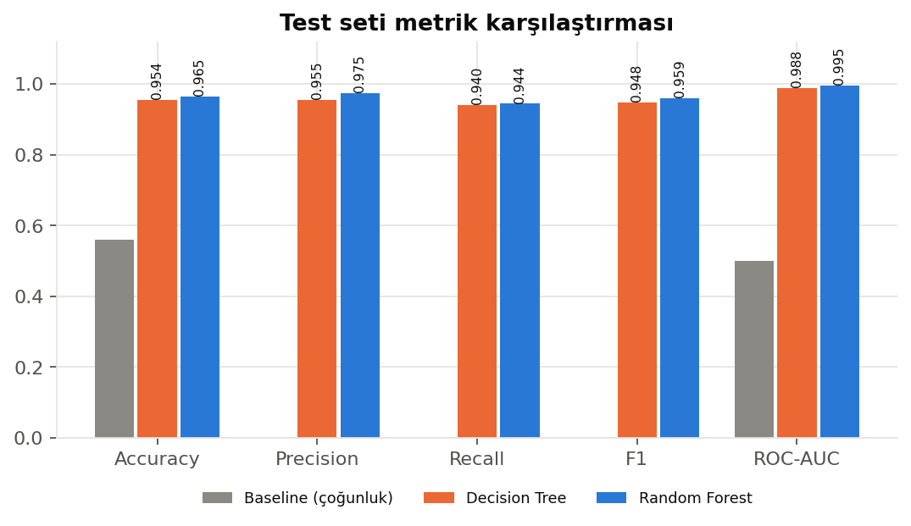
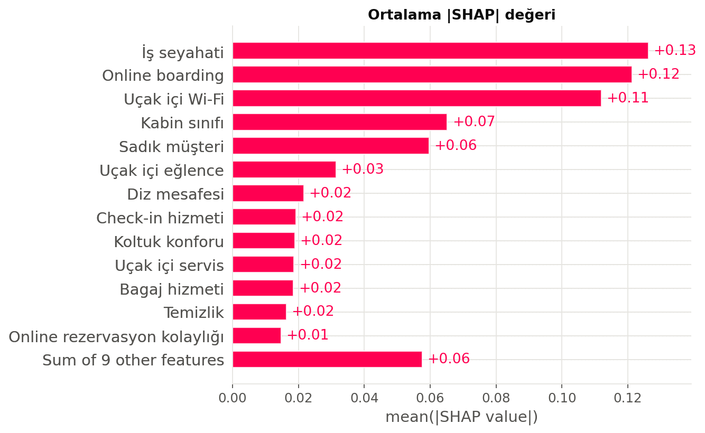
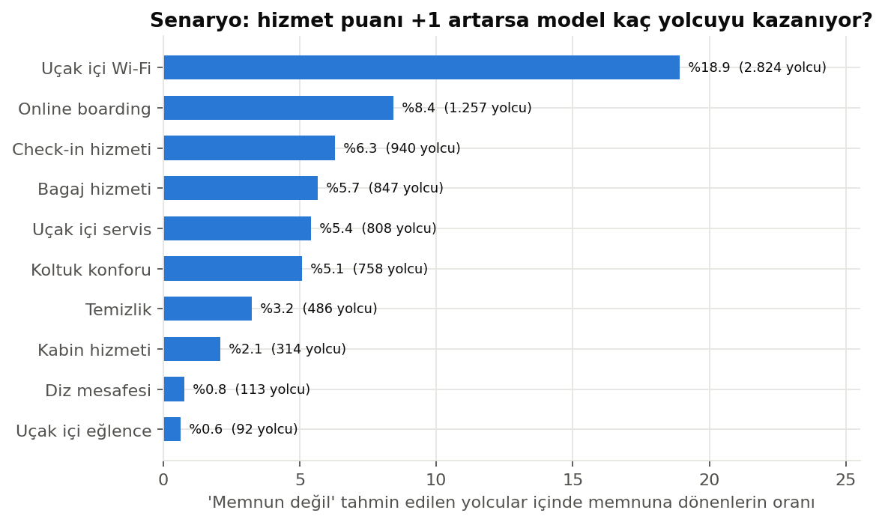
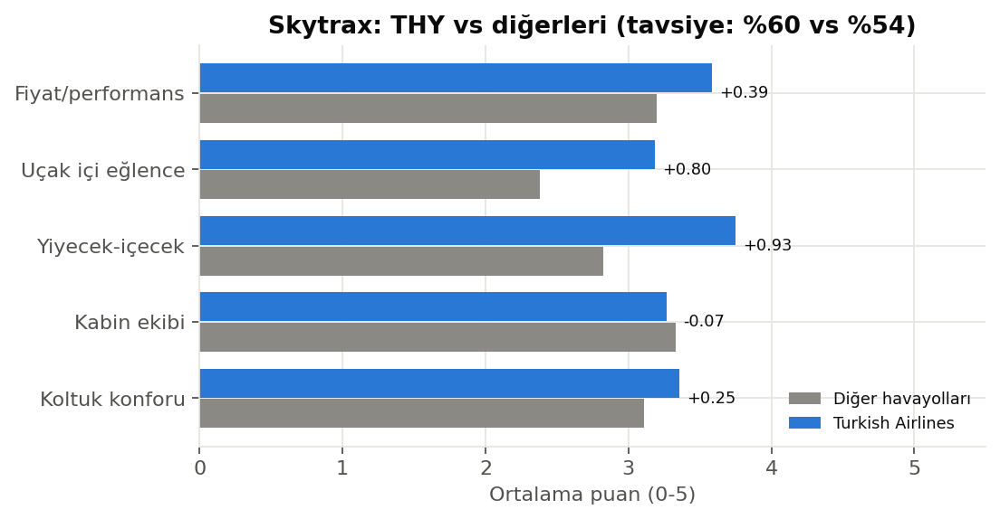

# Havayolu Yolcu Memnuniyeti Tahmini

**Diyar Sarı** · Yazılım Mühendisliği · 2309111133
Makine Öğrenmesi – Vize Projesi (U08) · İstinye Üniversitesi · Doç. Dr. Samet Gürsev

## Özet

Bu proje, 129.880 yolcunun anket yanıtlarından yolcunun uçuştan memnun olup olmadığını tahmin eder
ve bu tahmini hangi hizmetlerin belirlediğini açıklar. Kaggle *Airline Passenger Satisfaction*
veri setinde Decision Tree ve Random Forest modelleri, sızıntısız bir Pipeline, kapalı test seti ve
5-katlı çapraz doğrulama ile karşılaştırılmış; kararlar SHAP ile açıklanmıştır. Random Forest
test setinde **%96,47 doğruluk** ve **0,9948 ROC-AUC** elde etmiştir. Bulgular, kaynağı belli
Skytrax yolcu yorumlarında da sınanmış; eğitimde hiç kullanılmayan Turkish Airlines yorumlarında
model **%91,92 doğruluk** vermiştir.

## Öne çıkanlar

- **THY dış örneklem testi:** Skytrax'ta beş alt puanı da dolu 31.074 yorum (294 havayolu,
  2011–2015) analiz edildi; THY'nin 495 yorumu eğitimden tamamen çıkarıldı. Diğer havayollarında eğitilen Random Forest, ayrılmış test
  kümesinde %92,85, THY yorumlarında %91,92 doğruluk verdi (F1: 0,9338 / 0,9327).
- **Senaryo analizi:** Modelin "memnun değil" dediği 14.935 test yolcusunda Wi-Fi puanı +1
  artırıldığında 2.824 yolcu (%18,91) memnuna dönüyor; ikinci sırada online boarding (%8,42).
  Öncelik segmente göre değişiyor: Economy'de Wi-Fi (%18,67), Business'ta online boarding
  (%22,12) başta. Sonuçlar modelin öngörüsüdür, nedensel etki değildir.
- **Segment bazlı SHAP:** Economy'de en belirleyici özellik seyahat tipi (0,156), ardından Wi-Fi
  (0,120); Business'ta online boarding (0,136). Koltuk konforu, diz mesafesi ve uçak içi eğlence
  Business yolcusunda daha ağırlıklı.
- **McNemar testi:** Aynı test yolcularında RF'nin doğru, DT'nin yanlış bildiği 448 yolcuya
  karşılık tersi 176 (χ² = 117,69, p ≈ 2,0 × 10⁻²⁷). Doğruluk farkı 0,0105; bootstrap %95 güven
  aralığı [0,0086; 0,0123].
- **Hata analizi:** 25.976 test yolcusunda 916 hata (%3,53): 639 yanlış negatif, 277 yanlış pozitif.
  Hataların %39,08'i modelin kararsız olduğu 0,35–0,65 olasılık aralığında (doğru tahminlerde
  %2,40). En yüksek hata oranı sadık olmayan müşterilerde (%5,96).

## Sonuçlar

Test: Kaggle'ın ayrı test dosyası (25.976 yolcu). CV: eğitim setinde 5-katlı stratified çapraz
doğrulama (ortalama ± standart sapma).

| Model | Değerlendirme | Accuracy | Precision | Recall | F1 | ROC-AUC |
|---|---|---|---|---|---|---|
| Baseline (çoğunluk) | Test | 0,5610 | 0,0000 | 0,0000 | 0,0000 | 0,5000 |
| Decision Tree | Test | 0,9543 | 0,9548 | 0,9404 | 0,9475 | 0,9882 |
| Decision Tree | 5-katlı CV | 0,9527 ± 0,0017 | 0,9551 ± 0,0029 | 0,9349 ± 0,0028 | 0,9449 ± 0,0020 | 0,9878 ± 0,0011 |
| Random Forest | Test | **0,9647** | **0,9749** | **0,9440** | **0,9592** | **0,9948** |
| Random Forest | 5-katlı CV | 0,9641 ± 0,0009 | 0,9754 ± 0,0010 | 0,9410 ± 0,0022 | 0,9579 ± 0,0011 | 0,9948 ± 0,0003 |

| Test seti metrikleri | SHAP: ortalama \|SHAP\| değeri |
|---|---|
|  |  |
| **Senaryo analizi: hizmet puanı +1** | **Skytrax: THY ve diğer havayolları** |
|  |  |

Tüm grafikler [outputs/figures/](outputs/figures/), tüm sayısal sonuçlar
[outputs/metrics/](outputs/metrics/) klasöründedir.

## Veri

| Veri seti | Kullanım | Kaynak |
|---|---|---|
| Airline Passenger Satisfaction | Ana veri: 129.880 yolcu, 22 özellik, hazır train/test bölünmesi | [Kaggle](https://www.kaggle.com/datasets/teejmahal20/airline-passenger-satisfaction) |
| Skytrax reviews dataset | Dış doğrulama: airlinequality.com'dan 41.396 havayolu yorumu (Ağustos 2015 anlık görüntüsü) | [GitHub](https://github.com/quankiquanki/skytrax-reviews-dataset) |

Veri dosyaları lisans ve boyut nedeniyle repoda yer almaz:

1. **Kaggle:** Sayfadan *Download* ile zip dosyasını indirin; içindeki `train.csv` ve `test.csv`
   dosyalarını `data/raw/` klasörüne koyun. Kaggle API kuruluysa:
   ```powershell
   kaggle datasets download -d teejmahal20/airline-passenger-satisfaction -p data/raw --unzip
   ```
2. **Skytrax:** `python main.py` ilk çalıştırmada `airline.csv` dosyasını otomatik olarak
   `data/external/skytrax_airline.csv` adıyla indirir.

Skytrax deposu CC0-1.0 lisanslıdır; yorumların özgün yayın lisansı depoda belirtilmemiştir.
Ayrıntılar: [data/README.md](data/README.md).

## Kurulum ve çalıştırma

Python 3.10 ile test edilmiştir. Windows PowerShell:

```powershell
git clone https://github.com/DiyarSari/airline-passenger-satisfaction-ml.git
cd airline-passenger-satisfaction-ml
python -m venv .venv
.\.venv\Scripts\Activate.ps1
pip install -r requirements.txt
```

```powershell
python -m pytest -q          # birim testleri
python main.py               # uçtan uca akış, tüm çıktılar outputs/ altına (~10 dk)
python extra_analysis.py     # yalnızca ek analizler; main.py'nin kaydettiği modelleri kullanır
```

Hızlı deneme için arama ve SHAP örnek sayısı düşürülebilir:

```powershell
$env:SEARCH_ITER=4; $env:SEARCH_CV=2; $env:SHAP_SAMPLE=300; python main.py
Remove-Item Env:SEARCH_ITER, Env:SEARCH_CV, Env:SHAP_SAMPLE   # varsayılan ayarlara dön
```

Hızlı deneme de `outputs/` altındaki sonuçların üzerine yazar; raporlanan sonuçlar varsayılan
ayarlarla üretilmiştir.

Defterler `notebooks/` klasöründe 01 → 05 sırasıyla çalıştırılır. 03 ve 05, 02'nin kaydettiği
modelleri; 04 ise `main.py`'nin ürettiği `shap_siralama.csv` dosyasını kullanır.

## Proje yapısı

```
├── main.py                  # uçtan uca akış
├── extra_analysis.py        # senaryo, hata analizi, McNemar (kayıtlı modellerle)
├── src/
│   ├── config.py            # yollar, sütun grupları, model ayarları
│   ├── data_loader.py       # veri yükleme ve kalite raporu
│   ├── preprocessing.py     # AirlinePreprocessor (sklearn dönüştürücü)
│   ├── models.py            # baseline, DT, RF, hiperparametre araması, CV, derinlik eğrisi
│   ├── evaluation.py        # test metrikleri, grafikler, literatür karşılaştırması
│   ├── explainability.py    # Gini, permutation ve SHAP önemi
│   ├── skytrax.py           # Skytrax dış doğrulaması (THY)
│   ├── analysis.py          # senaryo, hata analizi, McNemar + bootstrap
│   └── visualization.py     # EDA grafikleri ve ortak stil
├── notebooks/               # 01 EDA · 02 Modelleme · 03 SHAP · 04 Skytrax · 05 Ek analizler
├── tests/                   # birim testleri (pytest)
├── data/
│   ├── README.md            # veri indirme adımları
│   ├── raw/                 # train.csv, test.csv (Kaggle; repoda yok)
│   └── external/            # skytrax_airline.csv (otomatik iner; repoda yok)
├── outputs/
│   ├── figures/             # grafikler
│   ├── metrics/             # sayısal sonuçlar (CSV, JSON)
│   └── models/              # eğitilmiş modeller (repoda yok)
├── requirements.txt
├── pyproject.toml           # ruff ve pytest ayarları
└── LICENSE
```

## Temel tasarım kararları

- **Kapalı test seti ve sızıntısız Pipeline:** Ön işleme ve model tek bir sklearn `Pipeline`
  içindedir; hiperparametre araması (RandomizedSearchCV, 15 deneme, 3 kat, F1) ve çapraz
  doğrulama yalnızca eğitim setinde yapılır. Test seti model eğitimi ve seçiminde kullanılmaz,
  yalnızca son değerlendirmede açılır (keşifsel grafikler tüm veri üzerindendir).
- **Eksik varış gecikmesi:** 393 eksik değer, aynı uçuşun kalkış gecikmesiyle doldurulur
  (iki sütun arasında r = 0,965).
- **Kodlama:** İkili değişkenler 0/1, kabin sınıfı sıralı (Eco < Eco Plus < Business) kodlanır.
  Hizmet puanlarındaki 0 değeri veri kartında "uygulanamaz" anlamına geldiği için ayrı bir değer
  olarak korunur. Ağaç tabanlı modeller ölçekten bağımsız olduğu için ölçekleme yapılmaz.
- **Referans noktaları:** Çoğunluk sınıfı baseline'ı ve karar ağacı derinlik eğrisi
  (doğrulama doğruluğu max_depth = 14'te en yüksek: 0,9511) modellerin değerlendirilmesine
  ölçü sağlar.
- **Üç önem ölçüsü:** Gini, permutation ve SHAP önemi birlikte raporlanır; ilişkili özelliklerde
  tek bir ölçü yanıltıcı olabilir.
- **Skytrax tasarımı:** Hedef `recommended` etiketidir. `overall_rating`, hedefle r = 0,867
  korelasyonlu olduğu için (hedef sızıntısı) kullanılmaz. THY yorumları eğitimden çıkarılarak
  dış örneklem olarak saklanır.

## Sınırlılıklar

- Kaggle veri setinin asıl kaynağı ve anket koşulları belirtilmemiştir; bu nedenle bulgular
  Skytrax yorumlarıyla ayrıca sınanmıştır.
- Analiz edilen Skytrax yorumları 2011–2015 dönemindendir ve gönüllü yorumlardan oluşur (seçim
  yanlılığı). İki
  veri setinde yalnızca dört ortak faktör vardır; faktör karşılaştırması niteldir.
- Model ilişkileri öğrenir, nedensellik göstermez. SHAP ve senaryo analizi modelin davranışını
  açıklar; bir iyileştirmenin gerçek etkisi kontrollü deney (A/B testi) gerektirir.
- Literatürdeki çalışmalar farklı bölünmeler ve ön işleme adımları kullandığından doğruluk
  değerleri birebir karşılaştırılamaz.

## Lisans

Bu proje [MIT Lisansı](LICENSE) ile lisanslanmıştır. Veri setleri kendi lisanslarına tabidir.
